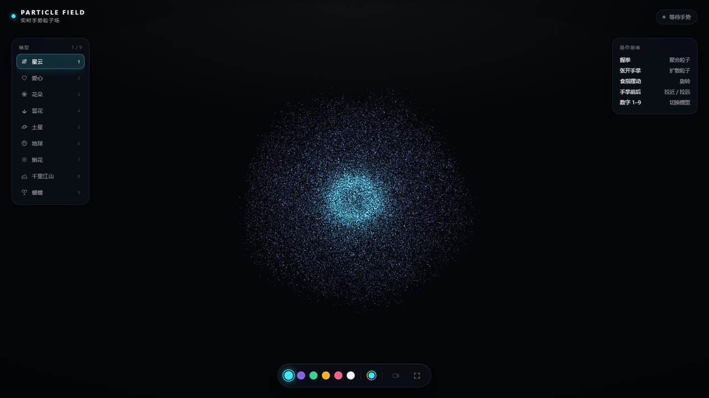
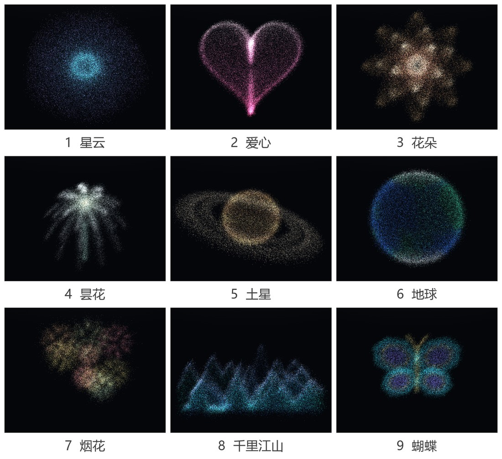

# 手势粒子场 · Hand Particle Field

> 用摄像头"抓住"一团粒子：基于 **MediaPipe Hands** 的手部关键点识别 + **Three.js / WebGL** 自定义着色器，
> 在浏览器里实时驱动 9 万粒子的聚合、扩散、旋转与推拉。
>
> 单文件网页应用，无需安装、无需构建，双击即玩。



## ✨ 功能特性

- **9 种程序化点云模型**：星云、爱心、花朵、昙花、土星、地球、烟花、千里江山、蝴蝶。全部由代码实时生成，不依赖任何模型文件。
- **4 类非接触手势**：握拳聚合、张掌扩散、食指摆动旋转、手掌前后推拉视距；手势输出为**连续控制量**而非离散标签，画面随动作平滑变化。
- **1.6 s 形态过渡**：切换模型时粒子先向外爆散再重新聚拢；连续快速切换也不会错乱（切换前把当前视觉状态折叠进起点缓冲）。
- **三色渐变配色**：6 组预设 + 自定义取色，辅色与高光色由主色在 HSL 空间自动派生。
- **完整界面**：运行状态胶囊、模型导航（1–9 快捷键）、操作指南、摄像头预览（21 点骨架叠加）、全屏。
- **容错设计**：CDN 双源回退；摄像头被拒绝或不可用时自动降级为鼠标拖拽旋转、滚轮缩放，页面不会白屏。



## 🚀 快速开始

**方式一：直接打开**

双击 `hand-particle-field.html`（推荐 Chrome / Edge 最新版）。

**方式二：本地服务器（摄像头更可靠）**

```bash
python -m http.server 8000
# 然后访问 http://localhost:8000/hand-particle-field.html
```

两点说明：

1. 首次运行需联网，Three.js（r158）与 MediaPipe Hands 由 jsDelivr / unpkg 加载，任一可达即可。
2. 摄像头需要**安全上下文**：`https://` 或 `http://localhost`。用 `file://` 直接双击时，部分浏览器会拒绝授权，
   此时仍可用鼠标拖拽旋转、滚轮缩放。

## 🖐 手势操作

| 手势 | 效果 | 判定方式 |
| --- | --- | --- |
| ✊ 握拳 | 粒子向中心聚合（扩散度 → 0.10） | 四指「指尖—腕点 / 指根—腕点」比值 < 1.42 |
| 🖐 张开手掌 | 粒子向外扩散（扩散度 → 1.0） | 四指比值 > 2.17，拇指张开度加权 0.15 |
| ☝️ 食指摆动 | 模型随指尖方向旋转，松手后惯性衰减 | 食指比值 > 1.7，其余三指均 < 1.65 |
| 🤚 手掌前后 | 视距在 0.6–1.65 倍之间推拉 | 手掌尺度相对缓慢自适应基线的比值 |

键盘：`1`–`9` 切换模型，`F` 全屏，`C` 显示/隐藏摄像头预览。鼠标：拖拽旋转，滚轮缩放。

## 🧠 实现要点

- **尺度无关的手势特征**：用「指尖到腕点的距离 / 指根到腕点的距离」代替绝对距离，
  同一阈值在 0.4 m–0.9 m 的手距下都成立；再叠加一阶指数阻尼抑制关键点抖动。
- **自适应基线**：手掌尺度用一个时间常数约 8 s 的阻尼器跟随，瞬间前后移动会立刻改变视距，
  长时间保持某距离后基线跟上、画面自动回到中性。
- **一次 draw call**：9 万粒子的位置、颜色标量、尺寸、随机种子全部放在 `BufferGeometry` 属性里，
  形变与着色都在 GPU 上完成，CPU 每帧只更新十几个 uniform。
- **着色器内形变**：`mix(position, aTo, uMorph)` + `sin(π·uMorph)` 爆散位移；
  点精灵圆形裁剪 + 三色 `smoothstep` 混合 + 加法混合，得到"光点"质感。

## 🗂 目录结构

```text
hand-particle-field/
├─ hand-particle-field.html   # 完整应用（HTML + CSS + JS + GLSL，单文件）
├─ hand-particle-field (2).zip# 同一 HTML 的压缩包，便于下发
├─ docs/                      # README 预览图
└─ README.md
```

## 🖥 环境与兼容

- 浏览器：Chrome / Edge 等支持 WebGL 1.0 与 `getUserMedia` 的 Chromium 内核浏览器。
- 移动端：自动把粒子数从 9 万降到 4.2 万，像素比上限 2。
- 无需 Node.js、无需 npm、无需构建步骤。

## ❓ 常见问题

**看不到摄像头画面？**
先用 `http://localhost` 打开而不是 `file://`；确认浏览器地址栏已允许摄像头权限。

**页面一直停在"正在进入粒子场…"？**
网络无法访问 CDN。可把 Three.js 与 MediaPipe 的脚本改成本地文件，或换一个可用的网络环境。

**没有检测到手？**
保持光线充足、手掌正对摄像头、手部完整入镜（约占画面 1/5 以上）。

**帧率偏低？**
集显设备上可关闭摄像头预览（按 `C`）；或在代码里把 `COUNT` 调小。

## 📄 说明

本项目为《视觉感知与应用》课程设计作品，仅用于学习与交流，未附加开源许可证。
